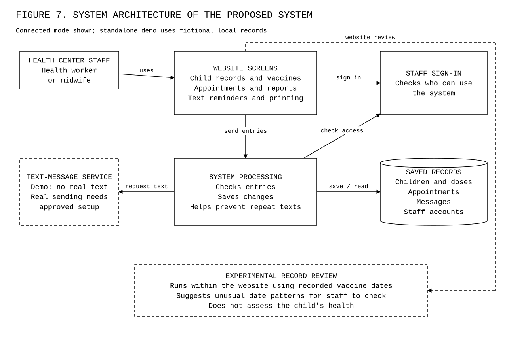
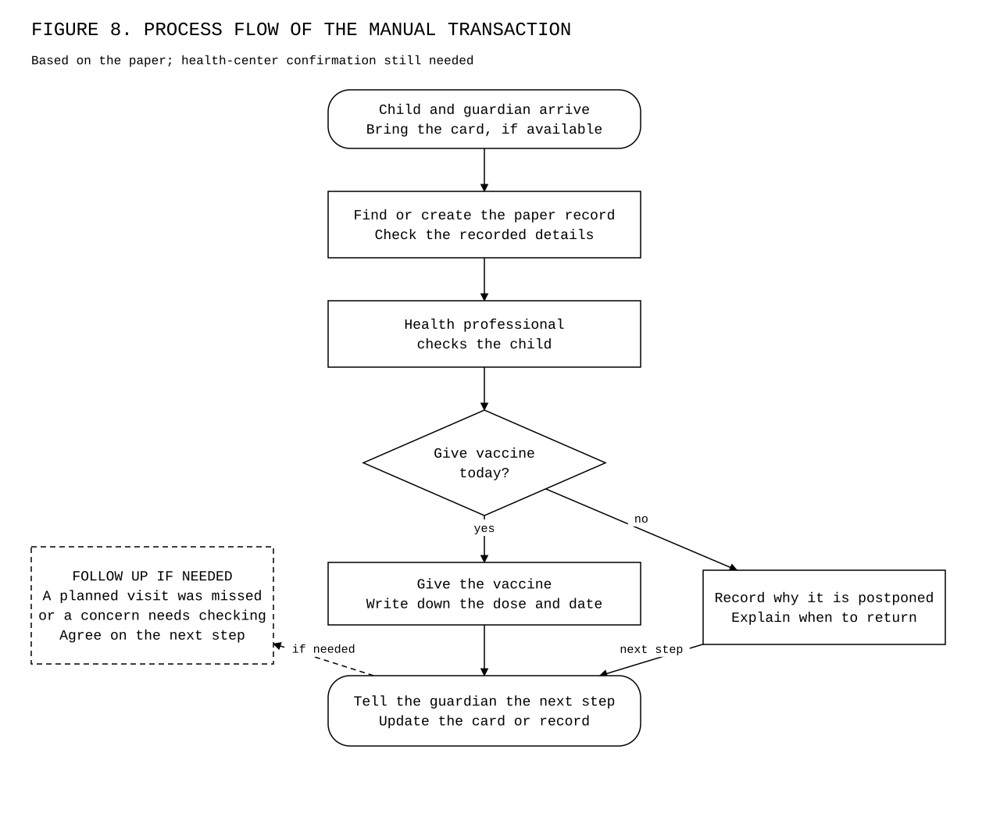
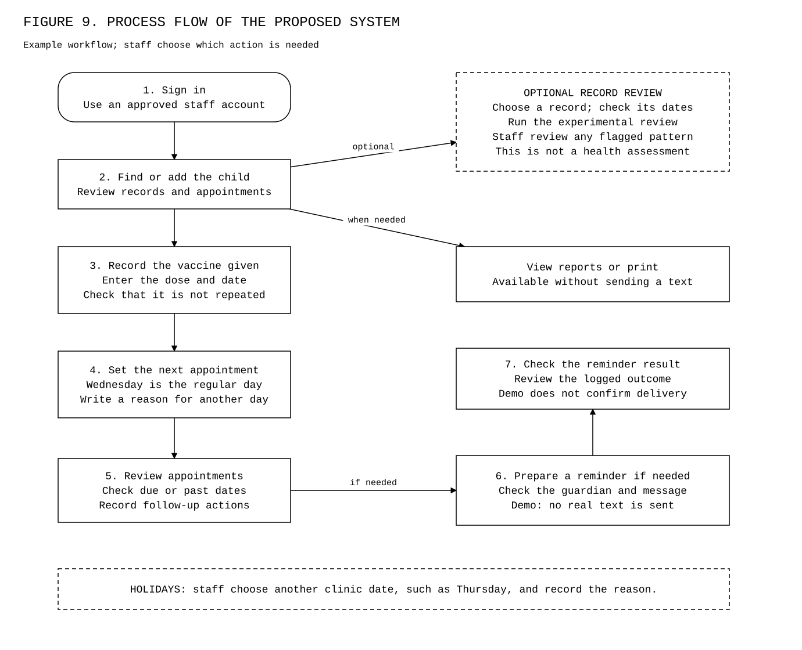
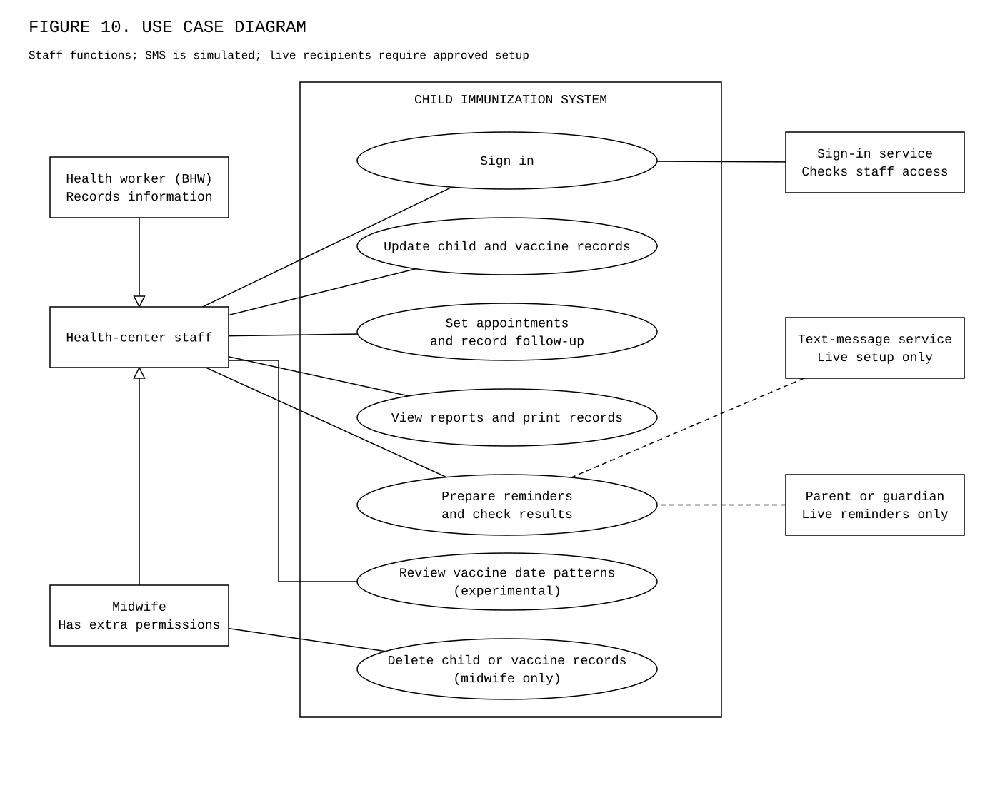
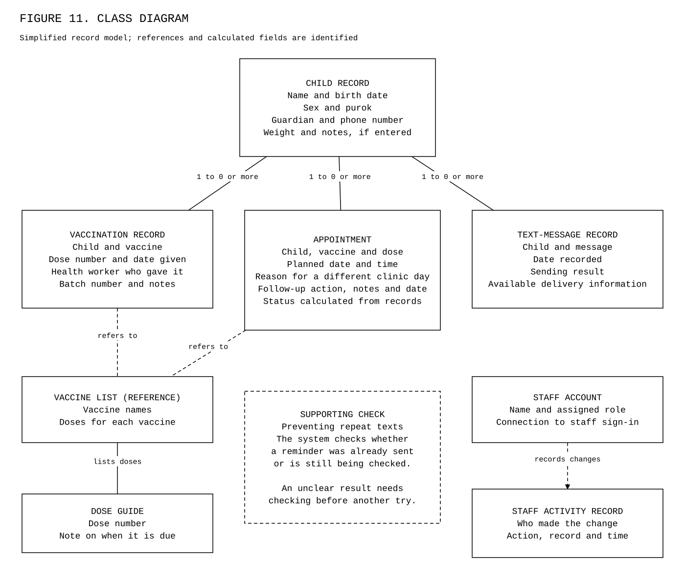
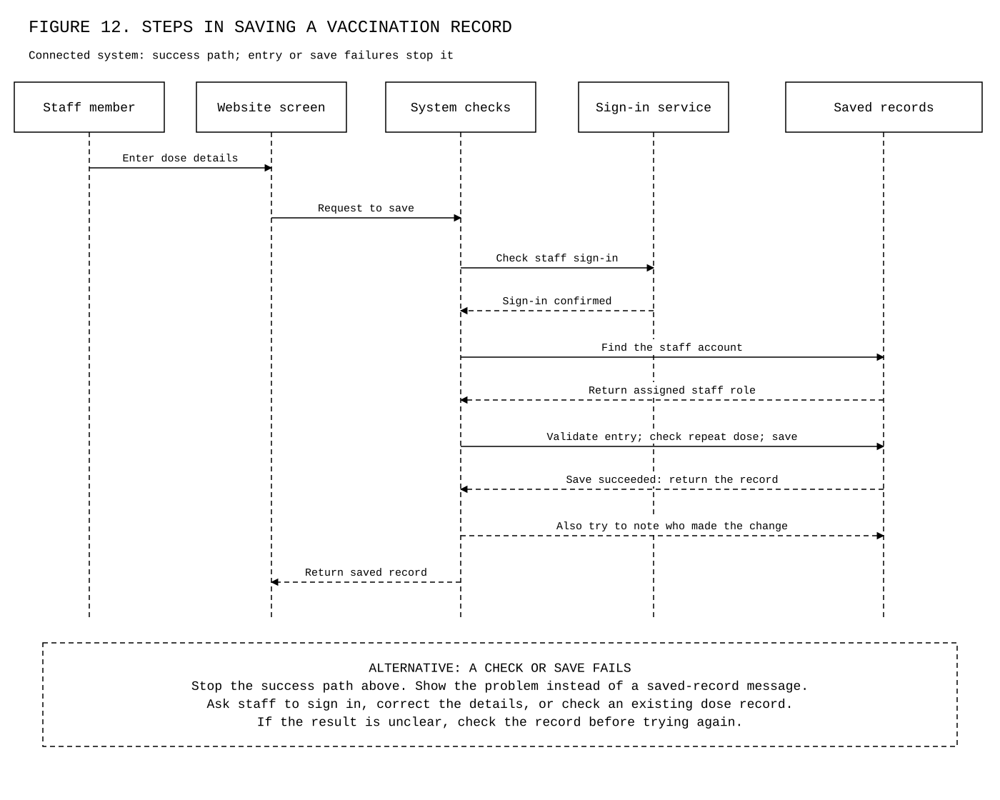
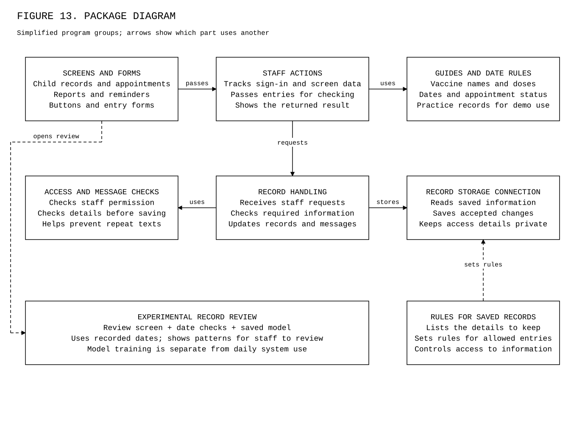
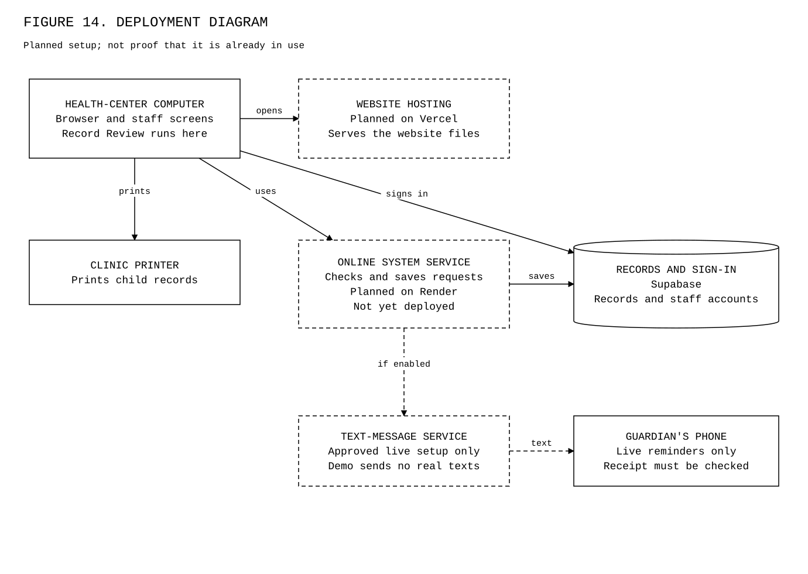

# Guide to the capstone diagrams

**Approved title:** AI-Powered Child Immunization Health Monitoring and Management System with SMS Notification in Barangay Homapon, Legazpi City

Updated 8 November 2026.

Open [the diagram viewer](architecture-viewer.html). All eight diagrams use Courier New, black lines and text, and white backgrounds. Labels use plain words. Figure numbers are retained for the later manuscript update.

Scope: corrected diagrams against the current local code and the user's decisions. Figures 7 and 9–14 and their explanations have been reconciled in the Word manuscript; the remaining figures await their section-by-section review. The manual clinic process remains unverified. The class and package diagrams are simplified views, not exhaustive code or database specifications.

## What changed

- Showed experimental Record Review in the architecture, proposed flow, use cases, and program groups. It runs in the website; model training is separate.
- Removed the implication that a past date proves a missed visit.
- Made reports and printing independent of sending a reminder.
- Limited the midwife-only deletion label to child and vaccination records, matching the server checks.
- Clarified one child to zero or more related records and the limited contents of the activity log.
- Separated the successful-save sequence from entry/save failure handling. Logging failure does not undo the saved vaccination.
- Marked Render as planned, not deployed, and demo messages as not reaching phones.

## Figure 7: System Architecture of the Proposed System

**Status:** Connected mode shown; standalone demo uses fictional local records.

Health workers use the website to keep child records, plan vaccination visits, prepare reports, and request text reminders. BHW means Barangay Health Worker.

Staff use the website to work with saved records. The connected system checks staff access before accepting changes. Record Review runs inside the website and checks patterns in recorded vaccine dates. It does not diagnose health, confirm an error, change records, or send texts. The diagram shows connected mode; the standalone demo uses fictional local records. Demo texts do not reach a phone; real sending needs a separately approved setup.

[Editable draw.io file](diagrams/architecture.drawio).

Evidence: [frontend/src/state/store.tsx](../frontend/src/state/store.tsx), [frontend/src/data/api.ts](../frontend/src/data/api.ts), [backend/src/app.js](../backend/src/app.js), [backend/src/lib/auth.js](../backend/src/lib/auth.js), [backend/src/routes/smsLog.js](../backend/src/routes/smsLog.js), [research/model-evaluation-2026-10-30/evaluate.py](research/model-evaluation-2026-10-30/evaluate.py), [frontend/src/pages/RecordReviewPage.tsx](../frontend/src/pages/RecordReviewPage.tsx), [frontend/src/utils/recordReview.ts](../frontend/src/utils/recordReview.ts).

## Figure 8: Process Flow of the Manual Transaction

**Status:** Based on the paper; health-center confirmation still needed.

This shows the paper-based visit described in the manuscript. A health professional decides whether a child should receive a vaccine.

Read from top to bottom. If the vaccine is given, staff record what was given and when. If it is postponed, staff explain the next step. They tell the guardian when to return. Follow-up is needed for a missed expected visit or another concern; an unfinished vaccine series does not automatically mean a missed visit. The health center still needs to confirm the exact steps.

[Editable draw.io file](diagrams/manual.drawio).

Evidence: [research/model-evaluation-2026-10-30/paper-alignment/capstone-paper-final.docx](research/model-evaluation-2026-10-30/paper-alignment/capstone-paper-final.docx), [health-center-confirmation.md](health-center-confirmation.md).

## Figure 9: Process Flow of the Proposed System

**Status:** Example workflow; staff choose which action is needed.

The system helps staff record vaccinations and plan visits. The regular clinic day is Wednesday. Staff choose another date when needed and write the reason.

This is an example of a visit and its follow-up, not a required order for every screen. Staff record a vaccine after it is given. The system compares appointment dates with saved doses. A past appointment date without a matching dose record needs follow-up; it does not prove that the child was absent. Optional Record Review needs all nine selected vaccine dates before it can run. Staff check the logged reminder outcome; a demo result does not confirm delivery. Reports and printing are also available without sending a text.

[Editable draw.io file](diagrams/proposed.drawio).

Evidence: [frontend/src/pages/ChildProfilePage.tsx](../frontend/src/pages/ChildProfilePage.tsx), [frontend/src/components/AppointmentDialog.tsx](../frontend/src/components/AppointmentDialog.tsx), [frontend/src/utils/clinicScheduling.ts](../frontend/src/utils/clinicScheduling.ts), [backend/src/routes/doseRecords.js](../backend/src/routes/doseRecords.js), [backend/src/routes/appointments.js](../backend/src/routes/appointments.js), [backend/src/routes/smsLog.js](../backend/src/routes/smsLog.js), [clinic-scheduling.md](clinic-scheduling.md).

## Figure 10: Use Case Diagram

**Status:** Staff functions; real guardian messages require approved setup.

Health workers and midwives share the main functions, including experimental Record Review. Only midwives can delete child and vaccination records. Guardians do not sign in.

Lines connect people and services to the functions they use. Empty triangle arrows show that BHWs and midwives are both health-center staff. Both roles can view reports and review date patterns. Deleting child and vaccination records is restricted to midwives; appointment deletion has no matching midwife-only check in the server code. Dashed links to the text service and guardian apply only to an approved live setup. Guardians do not sign in, and demo texts do not reach phones.

[Editable draw.io file](diagrams/usecase.drawio).

Evidence: [prd.md](../prd.md), [backend/src/lib/auth.js](../backend/src/lib/auth.js), [backend/src/routes/children.js](../backend/src/routes/children.js), [backend/src/routes/doseRecords.js](../backend/src/routes/doseRecords.js), [frontend/src/pages/ReportsPage.tsx](../frontend/src/pages/ReportsPage.tsx), [frontend/src/App.tsx](../frontend/src/App.tsx), [frontend/src/pages/RecordReviewPage.tsx](../frontend/src/pages/RecordReviewPage.tsx), [backend/src/routes/appointments.js](../backend/src/routes/appointments.js).

## Figure 11: Class Diagram

**Status:** Simplified record model; references and calculated fields are identified.

Each child record connects to vaccination records, appointments, and text-message records. Guardian details are included in the child record.

This is a simplified record class diagram. Each box names a record type and its information. The label 1 to 0 or more means one child may have no related entries yet, or many; each related entry belongs to one child. No invented operations or diagnosis fields are added. The vaccine list explains vaccine names and doses; it is a reference list kept with the website. Dashed lines show a reference or supporting action. The staff activity record stores the staff name, action, record type, identifier, and time when logging succeeds. It does not store a full before-and-after copy. No medical diagnosis or AI risk score is stored in these records.

[Editable draw.io file](diagrams/classes.drawio).

Evidence: [frontend/src/data/mockData.ts](../frontend/src/data/mockData.ts), [frontend/src/data/vaccines.ts](../frontend/src/data/vaccines.ts), [backend/supabase/schema.sql](../backend/supabase/schema.sql), [backend/supabase/rls.sql](../backend/supabase/rls.sql), [backend/supabase/migration-sms-reservations.sql](../backend/supabase/migration-sms-reservations.sql).

## Figure 12: Steps in saving a vaccination record

**Status:** Connected system: success path; entry or save failures stop it.

The staff member enters a vaccination that was already given. The system checks access and the entry before saving it.

Read the arrows from top to bottom. Each column is a person or part of the system. The system checks the staff account, the child record, and whether the same dose is already recorded. It then saves the entry and shows success. If a check or save fails, it shows a problem. The system also tries to note who made the change; failure to save that extra note does not undo the vaccination record.

[Editable draw.io file](diagrams/sequence.drawio).

Evidence: [frontend/src/state/store.tsx](../frontend/src/state/store.tsx), [frontend/src/data/api.ts](../frontend/src/data/api.ts), [backend/src/app.js](../backend/src/app.js), [backend/src/lib/auth.js](../backend/src/lib/auth.js), [backend/src/routes/doseRecords.js](../backend/src/routes/doseRecords.js), [backend/supabase/schema.sql](../backend/supabase/schema.sql).

## Figure 13: Package Diagram

**Status:** Simplified program groups; arrows show which part uses another.

The program has groups for screens, staff actions, entry checks, and saved records. Experimental Record Review runs in the website; model training is a separate preparation step.

The screen collects the staff member's entry. Other parts check it and send it to the saved records. The vaccine guide and date rules help the screens show useful information. Record rules describe which details belong in each record and which entries are allowed. These are parts of the existing program, not separate products that the health center must buy.

[Editable draw.io file](diagrams/packages.drawio).

Evidence: [frontend/src](../frontend/src), [backend/src](../backend/src), [backend/supabase](../backend/supabase), [research/model-evaluation-2026-10-30/evaluate.py](research/model-evaluation-2026-10-30/evaluate.py), [frontend/src/pages/RecordReviewPage.tsx](../frontend/src/pages/RecordReviewPage.tsx), [frontend/src/utils/recordReview.ts](../frontend/src/utils/recordReview.ts).

## Figure 14: Deployment Diagram

**Status:** Planned setup; not proof that it is already in use.

The planned setup connects a health-center browser to website hosting, backend processing, and managed sign-in and records. Live reminders require a separate approved setup.

The health-center computer opens the website. Online services check staff access and handle records. A text service can pass reminders to a guardian's phone, and a local printer can print child records. Render is the selected planned host for the main program; deployment is deferred. Experimental date review runs on the staff device inside the website. The diagram is a plan; it does not prove that the system is already running for the health center or that a message reached a phone.

[Editable draw.io file](diagrams/deployment.drawio).

Evidence: [prd.md](../prd.md), [frontend/package.json](../frontend/package.json), [backend/package.json](../backend/package.json), [sms-production-cutover.md](sms-production-cutover.md), [sms-reservations.md](sms-reservations.md).

## Hardware and Software Requirements of the Proposed System

A computer with a browser and an internet connection is needed for connected use. A printer is optional. Render is the selected planned backend host, but deployment is deferred. Real text sending needs an approved provider setup. Experimental Record Review runs in the browser without a separate model server. No measured minimum device specification is claimed.

## Checks and remaining limits

The focused viewer checks and browser checks passed on 8 November 2026: eight diagrams, 24 exports, Courier New, black and white, no detected clipping or overlapping labels, no browser errors, and no network requests. Rendered diagrams were visually inspected. No clinic tests, database writes, model training, or live SMS tests were repeated. Native files were checked structurally; no draw.io Desktop rendering is claimed. The clinic process and full paper alignment are still pending.

Maintain content in scripts/architecture-diagrams.cjs and the viewer shell in scripts/architecture-viewer.template.html; rebuild with node scripts/build-viewer.js. Preserve separate manual diagram edits before rebuilding.
